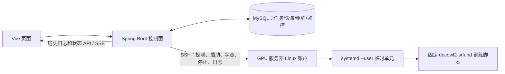

# GPUTrain 当前系统设计与训练数据链路

> 2026-10-10 的代码快照：`dev`，实现基线提交 `9cd8ff0c`。本文描述已提交代码可确认的设计；工作区另有未提交代码，实际部署版本需单独核对。原始方案见 [多服务器 SSH 设计](../superpowers/specs/2026-10-07-gputrain-agentless-multiserver-design.md)，功能缺口见 [设计评审](design-review-2026-10-10.md)。

## 边界和部署形态

浏览器只访问 Vue 前端和 Spring Boot 控制面；控制面持有 MySQL 中的服务器、账户、任务、GPU 快照、租约和监控数据，通过 SSH 连接 GPU 主机。目标机使用已有 Linux 账户、GPU 驱动、训练环境和用户级 `systemd`；新 SSH 任务不要求安装 GPUTrain Runner。旧 Runner 模块、接口及历史数据仍存在于仓库，不能把迁移设计中的“删除 Runner”视为已完成。

## 身份、服务器和设备

- `train_server` 是平台内的服务器身份；`train_server_account` 绑定服务器、若依用户和 Linux 登录账户。页面提供主机指纹预览、服务器/账户维护、连接测试、探测和设备查询，后端再次检查账户归属。
- 控制面固定 SSH 命令采集主机能力及 `nvidia-smi` 数据，保存逐服务器快照。GPU 身份以 `(server_id, gpu_uuid)` 定位；任务提交前必须基于新鲜快照重新验证设备与能力。
- 目标机的 `Linger=yes` 仅表示用户管理器可在退出登录后持续运行；它不是页面在线状态，也不能代替 SSH、认证、`systemd --user` 和训练 profile 的能力探测。

## 一次 SSH 训练的数据链路

1. 用户在任务表单选择服务器、本人授权账户及该服务器的三张 GPU，填写固定 profile 的 1–5 步参数和请求幂等键。后端校验 owner、服务器/账户匹配、GPU UUID、显存/进程/快照及训练目录约束。
2. 控制面先在 MySQL 持久化任务与请求键。`SshJobDispatcher` 定时选择到期任务，在短数据库事务中分配三张 GPU 的租约，随后领取待启动任务；SSH 副作用发生在事务外。
3. 控制面为任务 UUID 生成确定的 `gputrain-<uuid>.service` 单元名，在账户允许根目录下写 `run.sh`、`stdout.log`、`stderr.log`，通过 SSH 执行 `systemd-run --user --no-block`。脚本只允许固定可执行文件、白名单环境变量及经验证的参数，注入 `CUDA_VISIBLE_DEVICES`。
4. `SshJobReconciler` 每 10 秒检查非终态 SSH 任务，通过 `systemctl --user show` 对账。启动结果不明或 SSH 中断时进入 `UNKNOWN`/`RECONCILING`，保留租约；确认 `SUCCEEDED`、`FAILED` 或 `STOPPED` 等终态后才释放租约。停止操作也必须核对远端单元状态。
5. SSH 日志采集按流和字节偏移写入 `train_ssh_job_log`，解析训练指标并通过任务日志、SSE、指标、告警和资源接口展示。旧 Runner 任务走兼容历史查询路径。

控制面数据库与远程 `systemd` 没有分布式事务。唯一任务 UUID/单元名、请求幂等键和远程对账共同降低重复启动风险；远程终态证据缺失时不能仅凭日志内容释放 GPU 租约。

## 数据和接口契约

| 对象 | 主要用途 | 来源 |
| --- | --- | --- |
| `train_server`、`train_server_account` | 主机身份、指纹、账户归属及加密凭据 | `gputrain_phase8_ssh_servers.sql` |
| `train_server_gpu_device`、快照 | 按服务器保存物理 GPU 身份与最近观测 | `gputrain_phase8_ssh_servers.sql` |
| `train_job`、`train_server_gpu_lease` | 任务状态、请求幂等、三卡独占租约 | `gputrain_phase9_ssh_jobs.sql` |
| `train_ssh_job_log`、`train_ssh_job_metric` | SSH 任务日志与训练指标 | `gputrain_phase9_ssh_jobs.sql` |
| `train_job_alert` 等旧监控表 | 历史/兼容监控接口仍可能读取 | `gputrain_phase4.sql` |

主要 API：`/train/servers` 管理和探测服务器；`/train/jobs` 提交、查看、停止与取消；`/train/jobs/{id}/logs`、`logs/stream`、`metrics`、`alerts`、`resources` 查询监控。读取必须同时经过若依权限与任务/账户 owner 校验；页面不能把接口失败表示成“暂无数据”。

## 部署和迁移约束

首次初始化数据库与已有数据目录的升级是不同流程：MySQL 初始化脚本只在空数据目录执行。已有库必须按阶段核对并应用增量 SQL（尤其 Phase 4 监控表、Phase 8 服务器表、Phase 9 SSH 任务表），再启动对应版本后端。更新 `.env` 不会自动修改持久化 MySQL 用户密码；凭据轮换应分别修改数据库用户和后端连接配置并验证登录。任何迁移先备份，保留旧 Runner 历史表供查询。

## 当前证据边界

仓库存在 SSH 服务器管理、调度、对账、日志和页面实现；这说明代码路径已接入，不能替代真实多服务器验收。此前单次 1-step 训练的远端日志出现 `training complete` 和 checkpoint，页面任务终态仍显示待核对；曾因 `train_job_alert` 缺表导致监控报错。用户随后完成数据库/后端处理并反馈页面可用，但尚无独立证据证明终态、租约、指标、告警和多机能力均通过。验收标准与优先缺口见评审文档。
